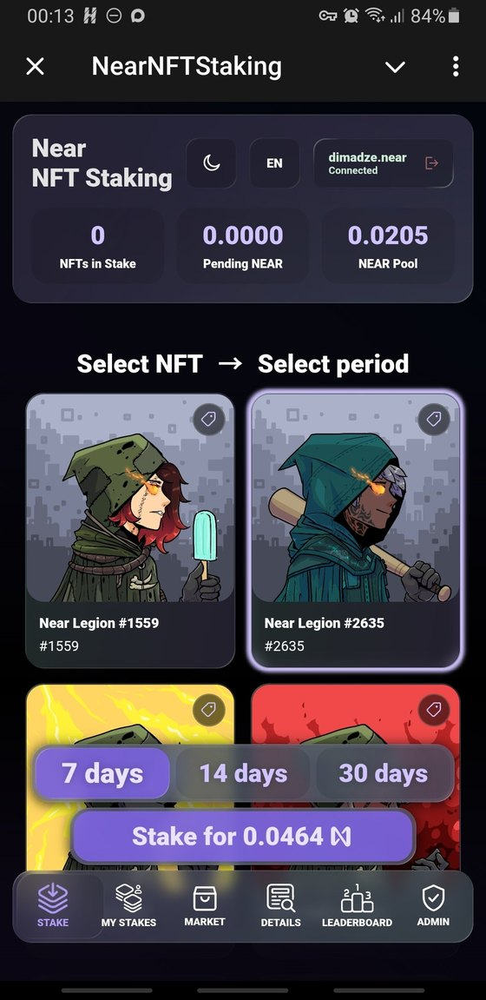
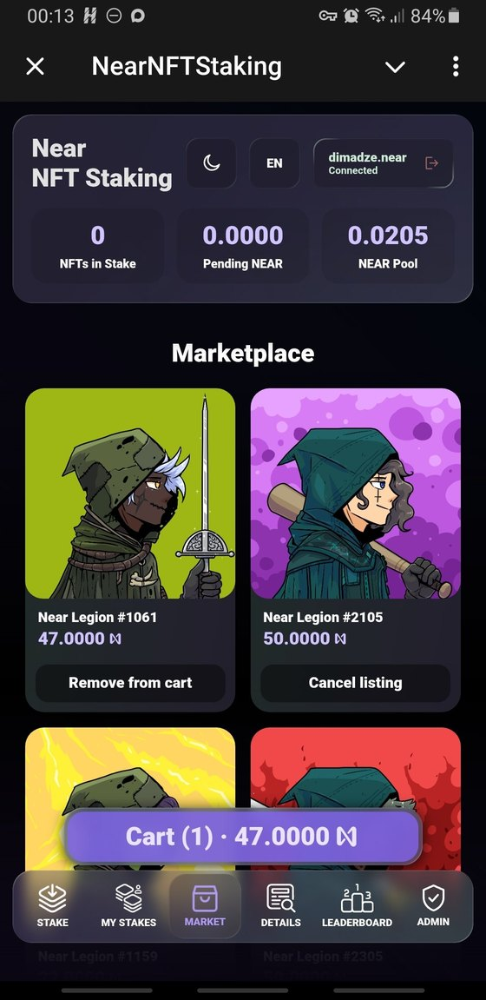
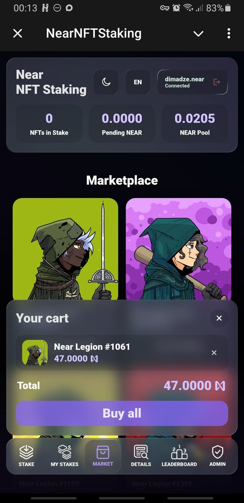

# NEAR Legion — NFT staking and marketplace inside Telegram

[](https://github.com/dimadze2116/Near-NFT-Staking/actions/workflows/contracts.yml)

An NFT that does three things after mint: earns a fixed, pre-funded reward while
staked, grants access to a private Telegram channel while held, and can be traded
on an escrow marketplace — all from a Telegram Mini App, with no browser
extension and no seed phrase.

Live on NEAR mainnet with real holders and real assets.

| Component | Mainnet account |
| --- | --- |
| Staking contract | [`legion-staking.near`](https://nearblocks.io/address/legion-staking.near) |
| Marketplace contract | [`legion-marketplace.near`](https://nearblocks.io/address/legion-marketplace.near) |
| NFT collection (third-party, NEP-171) | [`nearlegion.nfts.tg`](https://nearblocks.io/address/nearlegion.nfts.tg) |
| Telegram bot | [@NearNFTStaking_bot](https://t.me/NearNFTStaking_bot) |

---

## What the hackathon window added

This project did not start at the hackathon. The Mini App, both contracts and
the bot have been live on NEAR mainnet since June 2026, developed in a private
repository.

Commit [`48acd04`](https://github.com/dimadze2116/Near-NFT-Staking/commit/48acd04),
tagged `pre-hackathon`, is the import of that existing product into this public
repository on 19 October 2026. It is one commit, not one day of work —
everything in it predates the hackathon and is baseline.

What the window added is the diff:
[`pre-hackathon...main`](https://github.com/dimadze2116/Near-NFT-Staking/compare/pre-hackathon...main)

- **An integration test suite from zero.** There were none before. 18 tests run
  against a sandbox node, among them a parity test that deploys the previous
  mainnet bytecode beside the new build and requires 35 answers to match. CI
  runs them on every push to `contracts/`.
- **The last open security finding closed and deployed.** Creating a stake
  scanned the whole stake map twice, both times in the write path, so the cost
  of staking grew with every record ever created. Replaced with counters under
  their own storage keys — which needs no state migration, and whose way back
  is one call. Deployed to mainnet on 1 November 2026.
- **A pause for both contracts.** It refuses only the way in: `unstake` and
  `cancel_listing` are not pausable, because a pause that could trap someone
  else's NFT would not be a safeguard.
- **Dependency versions pinned.** The marketplace had no committed lockfile and
  resolved `near-sdk` afresh on every build; it had already drifted a minor
  version away from what the tests cover. Both contracts are now pinned, and
  their dependency trees are identical.
- **Wallet libraries pinned** in the Mini App, which previously resolved the
  newest version at runtime.
- **This README rewritten for judges**, with seven read-only mainnet calls
  anyone can run without a wallet, and [`ARCHITECTURE.md`](docs/ARCHITECTURE.md),
  [`SECURITY.md`](docs/SECURITY.md) and [`DEPLOYMENT.md`](docs/DEPLOYMENT.md)
  written from scratch.
- **All code comments translated to English**, 262 in the contracts and 75 in
  the bot. The bot's user-facing locale stays bilingual.

No libraries or templates were added during the window beyond the pinned
versions above. The contracts depend only on `near-sdk`, `borsh` and `serde`.

---

## The problem

Two problems, one product.

**An NFT stops doing anything the moment it is minted.** For most collections the
token is a static entry in a contract: it can be shown and it can be sold. Any
utility — yield, access, membership — has to be built separately, and usually
is not.

**On-chain onboarding loses the people a Telegram community already has.** The
standard path asks for a browser extension, a seed phrase and a funded account
before anything happens. For a community that lives in a Telegram channel, that
is where most members stop.

This project makes the NFT the account's working asset — it earns, it gates
access, it trades — and puts the whole flow inside Telegram, where the holders
already are.

---

## What it does

- **Staking.** Lock an NFT for 7, 14 or 30 days at a tiered APR, up to 4 NFTs in
  one transaction. The reward is deducted from the pool at the moment the stake
  is created, so every payout is funded before it is promised. If the pool cannot
  cover it, the NFT goes straight back to the sender instead of being locked.
- **Marketplace.** Escrow listings: the NFT moves to the contract, the price
  travels in `msg`. List, cancel, or buy up to 4 NFTs in a single transaction and
  a single signature. Fee is 0.5%.
- **Channel access.** Ownership is verified on-chain; a cron job re-checks twice
  daily and removes members who sold out and hold no active stake.
- **Leaderboard and rank**, computed from active stakes, with wallet names masked.
- **Notifications** when a stake matures or an NFT sells.

---

## Verify it without owning an NFT

Seven read-only mainnet calls. No wallet, no NFT, no sign-up.
Requires [near-cli-rs](https://github.com/near/near-cli-rs). Commands are written
for a POSIX shell; in PowerShell the inner quotes need escaping
(`json-args '{\"position\": 1}'`).

Amounts are `U128` and therefore serialise as JSON **strings**, not numbers —
that is deliberate, not a bug: yoctoNEAR values exceed what IEEE-754 doubles can
represent exactly.

All seven in one paste, if you would rather read the answers than type the calls.
Each line stands on its own; the sections below explain what to expect from each.

```bash
N="network-config mainnet now"
near contract call-function as-read-only legion-staking.near get_contract_stats json-args '{}' $N
near contract call-function as-read-only legion-staking.near get_apr_bps json-args '{"position": 1}' $N
near contract call-function as-read-only legion-staking.near preview_reward json-args '{"period_days": 7, "current_active_count": 0, "add_count": 1}' $N
near contract call-function as-read-only legion-staking.near get_claimed_stakes_count json-args '{}' $N
near contract call-function as-read-only legion-staking.near get_unique_claimers_count json-args '{}' $N
near contract call-function as-read-only legion-marketplace.near get_marketplace_stats json-args '{}' $N
near contract call-function as-read-only legion-marketplace.near get_fee_bps json-args '{}' $N
```

### 1. The contract is live and holds real positions

```bash
near contract call-function as-read-only legion-staking.near get_contract_stats \
  json-args '{}' network-config mainnet now
```

**See:** a JSON object with `owner_id`, `reward_pool`, `active_stakes`,
`matured_stakes`, `total_staked`, `unique_stakers`. All amounts are yoctoNEAR
strings. `owner_id` is `legion-staking.near` itself — the contract owns itself;
see [Security](#security) for why.

### 2. The APR really is tiered by position

```bash
near contract call-function as-read-only legion-staking.near get_apr_bps \
  json-args '{"position": 1}' network-config mainnet now
```

**See:** `2420` — 24.20% APR, in basis points. Then try other positions:

| `position` | Returns | APR |
| --- | --- | --- |
| 1–10 | `2420` | 24.20% |
| 11–20 | `2904` | 29.04% |
| 21–30 | `3319` | 33.19% |
| 31–40 | `3733` | 37.33% |
| 41–50 | `4148` | 41.48% |
| 51+ | `4205` | 42.05% (capped) |

Position means the n-th NFT staked by that account, not a global ranking.

### 3. The reward formula is deterministic and checkable by hand

```bash
near contract call-function as-read-only legion-staking.near preview_reward \
  json-args '{"period_days": 7, "current_active_count": 0, "add_count": 1}' \
  network-config mainnet now
```

**See:** exactly `"46410958904109589041095"` — that is 0.046411 NEAR.

Verify it yourself: the contract values one NFT at 10 NEAR
(`NFT_VALUE_YOCTO`), so
`10e24 × 2420 × 7 / 10000 / 365 = 46410958904109589041095`.
Integer division only, no floats anywhere in the reward path.

A longer period scales linearly — `{"period_days": 30, "current_active_count": 0, "add_count": 1}`
returns `198904109589041095890410` (0.198904 NEAR).

### 4. The marketplace holds real listings in escrow

```bash
near contract call-function as-read-only legion-marketplace.near get_listings \
  json-args '{"from_index": 0, "limit": 50}' network-config mainnet now
```

**See:** an array of `{token_id, seller, price, listed_at}`. Each `token_id` in
that array is currently owned by `legion-marketplace.near`, not by its seller —
that is what escrow means here. Cross-check any one of them:

```bash
near contract call-function as-read-only nearlegion.nfts.tg nft_token \
  json-args '{"token_id": "<token_id from above>"}' network-config mainnet now
```

**See:** `owner_id` equal to `legion-marketplace.near`.

### 5. The fee is what this README claims

```bash
near contract call-function as-read-only legion-marketplace.near get_marketplace_stats \
  json-args '{}' network-config mainnet now
```

**See:** `active_listings` — the number of listings currently in escrow, which
is the count the call in step 4 pages through — and `fees_collected`, the fees
accumulated from completed sales in yoctoNEAR. `get_fee_bps` returns `"50"`,
i.e. 0.5%.

`fees_collected` is a running total that *decreases* when fees are withdrawn, so
it is a treasury balance, not historical volume. Worth knowing before reading
anything into it. At 50 bps, the `19000000000000000000000` standing there at the
time of writing accounts for at least 3.8 NEAR of completed sales — a floor, for
that same reason, not a total.

### 6. The deployed code is the code in this repository

Do **not** compare checksums — the contracts are built with
`non-reproducible-wasm`, so the same source produces different bytes on every
build and a local hash will never match the on-chain one. Verify by behaviour
instead:

```bash
near contract call-function as-read-only legion-staking.near admin_return_nft \
  json-args '{"stake_id": "anything"}' network-config mainnet now
```

**See:** the call *fails*, and that failure is the proof. The error carries
`HostError(GuestPanic { panic_msg: "attach exactly 1 yoctoNEAR" })` — the method
resolved, ran, and refused on its access check, which means the deployed build
contains this repository's `admin_return_nft`. A build without it would answer
`MethodResolveError(MethodNotFound)` instead, which is a different error from a
different stage.

### 7. People have actually used it

```bash
near contract call-function as-read-only legion-staking.near get_claimed_stakes_count \
  json-args '{}' network-config mainnet now

near contract call-function as-read-only legion-staking.near get_unique_claimers_count \
  json-args '{}' network-config mainnet now
```

**See:** `"73"` and `"23"` at the time of writing — 73 completed staking cycles
across 23 distinct accounts, so roughly three cycles per account: people came
back. A cycle counts only after a successful `unstake` whose NFT transfer *and*
reward payment both resolved, which is why these two numbers are the hardest
thing in this README to fake. Both only ever grow, so larger values mean more
cycles since.

`get_claimed_stake_ids` lists the keys behind that count, and
`get_claimed_stakes` pages through them with amounts and dates, if you want to
look at individual cycles rather than the total.

---

## Try it in Telegram

Open [@NearNFTStaking_bot](https://t.me/NearNFTStaking_bot) and send `/start`.

**Without a NEAR Legion NFT** you can see: the wallet connection flow (NEP-413
signed message), `/pool` with the live reward pool, `/status`, and the Mini App's
marketplace tab with real listings. Staking and channel access require a token
from the collection — the gate is on-chain, not a setting.

**With an NFT,** the full path is:

1. `/start` → connect wallet → sign the NEP-413 message
   → **see** the bot confirm the account and grant the private-channel invite
2. `/stake` → opens the Mini App → **see** your NFTs loaded from
   `nearlegion.nfts.tg`
3. Select NFTs and a period → **see** the exact reward before signing, computed
   by `preview_reward` against your current position
4. Sign → **see** the stake appear under `/mystakes` with its unlock timestamp
5. Marketplace tab → add up to 4 listings to the cart → **see** one transaction
   and one signature transfer all of them
6. After the period elapses → `/claim` → **see** the NFT returned and the reward
   paid

**One thing to check first:** call `get_reward_pool`. New stakes are only
accepted while the pool can fully cover the reward. If the pool is near zero,
`nft_on_transfer` returns the NFT to you instead of locking it — a deliberate
solvency guard, not a failure. Existing stakes are unaffected and unstake
normally.

The Mini App needs Telegram's `initData` to authenticate, so it only signs when
opened through the bot. Opened directly in a browser it renders but cannot
transact.

---

## Run it locally

### Contracts

```bash
cd contracts/staking      # or contracts/marketplace
cargo near build non-reproducible-wasm --no-abi
```

Only this command produces a working binary. A plain
`cargo build --target wasm32-unknown-unknown` compiles, deploys, and then traps
at `new()` with `WasmTrap(Unreachable)` — since near-sdk 5.27 the `--cfg near`
flag is required and only `cargo near build` supplies it. See
[`docs/DEPLOYMENT.md`](docs/DEPLOYMENT.md).

### Bot

```bash
cd bot
cp ../.env.example .env   # fill in your own values
npm install
npm run build
npm start
```

### Mini App

```bash
cd app
npm install
npm run dev
```

---

## Screenshots

| Staking | Marketplace | Cart |
|:---:|:---:|:---:|
|  |  |  |
| NFTs and period selected, reward shown before signing | Listings with per-item actions — the seller sees *Cancel*, everyone else *Add to cart* | Up to 4 NFTs in one transaction and one signature |

| Leaderboard | Details |
|:---:|:---:|
|  |  |
| Ranked by active stakes, wallet names masked | Tiered APR table and live contract addresses |

---

## Repository layout

```
contracts/
  staking/        Rust, near-sdk 5.1 — staking, tiered APR, leaderboard
  marketplace/    Rust, near-sdk 5.1 — escrow listings, cart purchase, 0.5% fee
bot/
  src/            TypeScript — Telegram bot, REST API, cron, SQLite
app/
  src/            React + Vite — the Telegram Mini App
docs/
  ARCHITECTURE.md How the pieces fit together
  SECURITY.md     Internal review: all 15 findings, what was fixed and how
  DEPLOYMENT.md   Build and deploy, including the parts that cost real time
```

---

## Security

**No private keys on the server.** The contract owner is the contract account
itself, holding a single full-access key. Putting that key in an environment
variable would hand over the contract, not just the reward pool, so every
state-changing administrative operation is performed manually through
`near-cli`: the bot generates the command with the amount already converted to
yoctoNEAR, and a human signs it. `bot/src/near.ts` is read-only by
construction — the key-handling code was deleted rather than guarded.

**Internal review: 15 findings, all 15 fixed and live on mainnet.** The most
serious one:
`nft_on_transfer` derived stake ownership from `sender_id`, which under NEP-171
differs from the owner whenever a NEP-178 approval is used — an approved account
could stake someone else's NFT and claim it as its own. Ownership now comes from
`previous_owner_id`. The full list, including what is still open and why, is in
[`docs/SECURITY.md`](docs/SECURITY.md).

**Other properties:** both contracts build with `overflow-checks = true` and
`panic = "abort"`. Privileged methods require exactly 1 yoctoNEAR, so they
cannot be invoked with a function-call access key. `admin_return_nft` reads the
recipient from contract state instead of taking it as a parameter and only works
90 days past unlock — the owner can trigger a return but cannot choose who
receives the NFT.

---

## Adding another collection

Both contracts bind to one collection through a single constant:

```rust
// contracts/staking/src/lib.rs:8
const NFT_CONTRACT_ID: &str = "nearlegion.nfts.tg";
```

Nothing else depends on which collection it is — not the reward math, not the
escrow path, not the gas budget. Apart from its definition the constant appears
three times in the staking contract and four in the marketplace, and nowhere
else: the cross-contract calls that move an NFT, and the check that the caller
of `nft_on_transfer` really is the collection. Stake and listing records key on
`token_id` alone.

Supporting a second collection is therefore a second deployment, not a rewrite:
change the constant, rebuild, deploy to a new account, point the bot at it.

The same fact sets the limit. One instance cannot serve two collections at
once, because `token_id` is not namespaced and tokens from different
collections would collide. Making a single instance multi-collection needs a
state migration, and that is not done.

---

## Known limitations

- **Cart capped at 4 items.** A gas ceiling, not a product decision: measured on
  this collection, `nft_transfer` burns 3.53 TGas, and four transfers with their
  callbacks fit under the 300 TGas transaction limit with margin. The limit is
  enforced in the contract and mirrored client-side, so the user is told before
  signing rather than after.
- **`MAX_ACTIVE_STAKES = 300`** globally, which keeps the reward budget provably
  bounded.
- **No owner transfer.** Not implemented, and no field is reserved for it: the
  staking contract's state holds `owner_id`, the two stake maps and
  `reward_pool`, and nothing else. Adding it later means either a state
  migration or the storage-key approach the counters already use. It is also not
  obviously wanted: the owner is the contract account itself, and pointing it at
  a personal account would widen what a compromise of that account costs.
- **No formal third-party audit.** At current volumes that would be premature;
  it is the natural next step as the project scales.

---

## License

MIT — see [`LICENSE`](LICENSE).

---

## Made

What this project was built with, and how.

### How it was built

Built with AI, under the maintainer's direction and review. The work runs
through **IronClaw — local version**, a local agent harness; the models below
write and review code, and nothing lands unread.

AI:

1. DeepSeek V4 Flash from DeepSeek
2. GPT 5.4 Mini from OpenAI
3. Claude Sonnet 4.6 from Anthropic
4. Claude Opus 4.6 from Anthropic
5. Claude Opus 5 from Anthropic

Two things are deliberately not automated. No private key is reachable by any
agent or by the server: every contract deployment and every state-changing
mainnet call is signed by hand from the owner's machine, which is why the bot's
admin commands only *print* a ready-to-paste `near-cli` line (see
[`docs/SECURITY.md`](docs/SECURITY.md)). And nothing reaches mainnet on an
agent's say-so — the deployment order in
[`docs/DEPLOYMENT.md`](docs/DEPLOYMENT.md) is followed by a person.

The project predates this hackathon and has been live since June 2026. What the
window added is the diff linked in
[What the hackathon window added](#what-the-hackathon-window-added); the commit
tagged `pre-hackathon` is the boundary.

### Libraries

No template and no fork — the project was written from scratch. These are the
dependencies:

**Contracts.** `near-sdk 5.29.1` (pinned to `~5.29.1`, `Cargo.lock` committed —
the reasoning is in the `Cargo.toml` comment), `borsh 1`, `serde 1`. The
integration tests deliberately depend on none of them: `near-workspaces 0.23`
against a sandbox node, plus `tokio`, `anyhow` and `serde_json`.

**Bot.** `telegraf 4`, `express 4`, `near-api-js 5`, `near-kit 0.14`,
`node-cron 3`, `sql.js 1.12`, `tweetnacl 1`, `@scure/base 1.1`, `dotenv 16`,
TypeScript 5.4.

**Mini App.** React 19 with Vite 8, linted by `oxlint`. Wallet connection is not
bundled: `@hot-labs/near-connect 0.11.4` and `near-kit 0.20.2` load from esm.sh
at runtime, pinned by exact version in the import URL. Telegram's
`telegram-web-app.js` is loaded from telegram.org.
