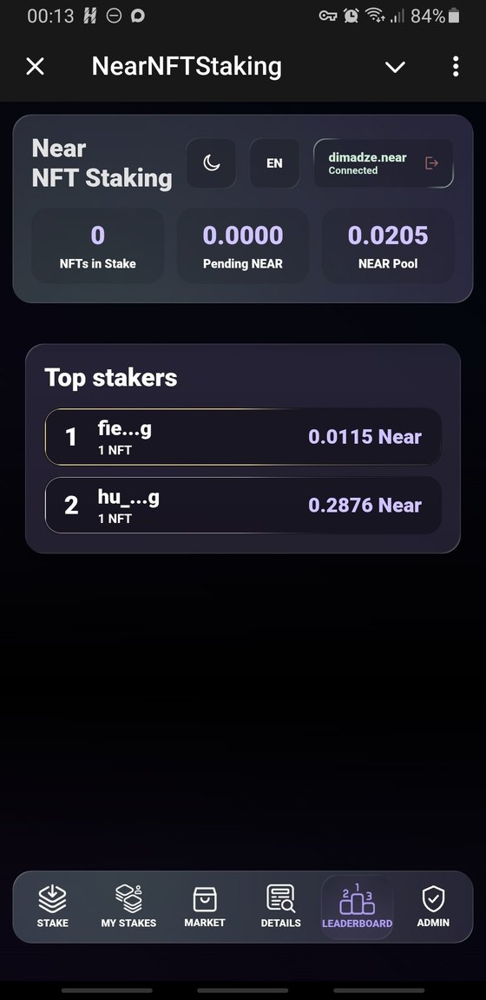
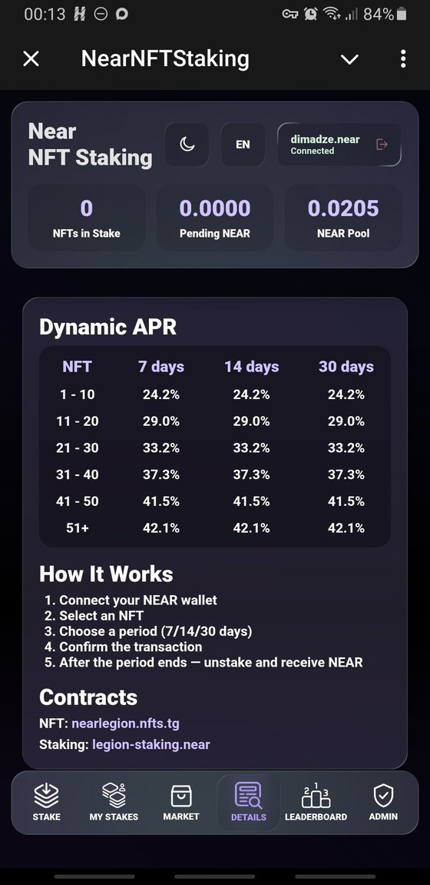

# NEAR Legion — NFT Staking & Marketplace

NFT staking and a peer-to-peer marketplace for the **NEAR Legion** collection, delivered entirely inside Telegram as a Mini App. Live on NEAR mainnet with real users and real assets.

| Component | Mainnet account |
| --- | --- |
| Staking contract | [`legion-staking.near`](https://nearblocks.io/address/legion-staking.near) |
| Marketplace contract | [`legion-marketplace.near`](https://nearblocks.io/address/legion-marketplace.near) |
| NFT collection | [`nearlegion.nfts.tg`](https://nearblocks.io/address/nearlegion.nfts.tg) (NEP-171) |

Bot: [@NearNFTStaking_bot](https://t.me/NearNFTStaking_bot)

---

## What it looks like

| Staking | Marketplace | Cart |
|:---:|:---:|:---:|
|  |  |  |
| Pick NFTs and a period, see the reward before signing | Listings with per-item actions — the seller sees *Cancel*, everyone else *Add to cart* | Up to 4 NFTs bought in one transaction and one signature |

| Leaderboard | Details |
|:---:|:---:|
|  |  |
| Ranked by active stakes, wallet names masked for privacy | Tiered APR table and live contract addresses |

---

## What it does

A holder of a NEAR Legion NFT connects their wallet inside Telegram, proves ownership on-chain, and gets access to a private channel. From the same Mini App they can:

- **Stake NFTs** for 7, 14 or 30 days at a tiered APR, up to 4 at a time
- **Trade NFTs** on an escrow marketplace — list, cancel, or buy up to 4 in a single transaction
- **Track** active stakes, reward pool, leaderboard and personal rank
- **Get notified** when a stake matures or an NFT sells

Rewards are reserved from the pool at the moment a stake is created, so every payout is funded before it is promised. If the pool cannot cover a new stake, the NFT is returned to the sender instead of being locked.

---

## Why it's interesting

**Onboarding without the usual cliff.** No browser extension, no seed-phrase literacy. A Telegram user taps a button, signs once with a wallet that already lives on their phone, and is in. This is NEAR's abstracted-onboarding thesis in a working product rather than a deck.

**It survived contact with reality.** The contracts hold third-party assets and have been through an internal security review that found 15 issues — including one that let an approved account steal someone else's NFT. Fourteen are fixed and redeployed; the process is documented in [`docs/SECURITY.md`](docs/SECURITY.md).

**Decisions are measured, not guessed.** The 4-item cart limit is derived from actual mainnet gas consumption (`nft_transfer` on this collection burns 3.53 TGas, not the 50 originally reserved). The reasoning behind each non-obvious constraint is written down.

---

## Repository layout

```
contracts/
  staking/        Rust, near-sdk 5.1 — staking, tiered APR, leaderboard
  marketplace/    Rust, near-sdk 5.1 — escrow listings, cart purchase, 0.5% fee
bot/
  src/            TypeScript — Telegram bot, REST API, cron, SQLite
app/
  src/            React + Vite — the Telegram Mini App
docs/
  ARCHITECTURE.md How the pieces fit together
  SECURITY.md     The review, what it found, how it was fixed
  DEPLOYMENT.md   Build and deploy, including the non-obvious parts
```

---

## Running it

### Contracts

```bash
cd contracts/staking      # or contracts/marketplace
cargo near build non-reproducible-wasm --no-abi
```

Only this command produces a working binary — see [`docs/DEPLOYMENT.md`](docs/DEPLOYMENT.md) for why a plain `cargo build` compiles, deploys, and then traps.

### Bot

```bash
cd bot
cp ../.env.example .env   # fill in your own values
npm install
npm run build
npm start
```

### Mini App

```bash
cd app
npm install
npm run dev               # or: npm run build
```

The Mini App needs Telegram's `initData` to authenticate, so wallet connection and transactions only work when opened through the bot. Opened directly in a browser it renders, but cannot sign.

---

## Security posture

No private keys live on the server. The contract owner is the contract account itself, holding a single full-access key — putting that in an environment variable would hand over the contract, not just the reward pool. Every state-changing operation is performed manually through `near-cli`; the bot generates the command and the administrator signs it.

Both contracts build with `overflow-checks = true` and `panic = "abort"`. Privileged methods require exactly 1 yoctoNEAR, so they cannot be called with a function-call access key. Emergency asset recovery reads the recipient from contract state rather than taking it as a parameter — the owner can trigger a return but cannot choose who receives the asset.

Details, including the full list of findings, are in [`docs/SECURITY.md`](docs/SECURITY.md).

---

## Status

Live on mainnet. A formal third-party audit has not been commissioned — at current volumes that would be premature, and it is the natural next step as the project scales.

## License

MIT — see [`LICENSE`](LICENSE).

---

## Made

IronClaw — local version

AI:
1. DeepSeek V4 Flash from DeepSeek
2. GPT 5.4 Mini from OpenAI
3. Claude Sonnet 5 from Anthropic
4. Claude Opus 4.6 from Anthropic
5. Claude Opus 5.0 from Anthropic
